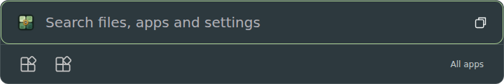
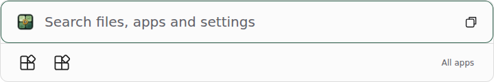

# Quick launcher design QA

The selected reference is the central two-row PowerToys launcher supplied in the task. The surrounding announcement, wallpaper and Microsoft branding are outside the app surface.

The implementation keeps a broad search header above a separated app-icon strip, a dark blue-gray surface, restrained rounding and a compact expand action. The Windows home is 720 × 120 logical pixels where the work area permits; narrower work areas are clamped. DigUp retains its own logo, native app icons, shared moss focus and existing result ordering.

## Visual evidence

These are screenshots of the production page at implementation commit `60219f9`, rendered by hosted Chromium with a synthetic native boundary. They establish page layout, not Windows compositor behavior. The fixture has two available apps; the real strip resolves up to six visible pinned/recent identities.

Visual comparison found that generic icons were too dark when the app explicitly selected Dark while the OS preferred Light. The fallback now follows the selected theme, and the regression checks its computed filter. Actual Windows icons keep their colors. Search text, icon alignment, row divider and expand action remain readable in both captures.

The surface remains solid until native transparency passes the existing WebView2 pixel checks. The reference's backdrop blur is not claimed as implemented.

## Interaction and automated evidence

The hosted browser pass at `60219f9` includes:
- Pinned/recent ordering, keyboard entry into the strip, arrow navigation and ID-only launch dispatch.
- Visible launch failure with Retry/Dismiss and focus restoration.
- Empty-home to search-results transitions, 360/720-pixel widths, Light and Dark.
- Both search views, current-generation replies, delayed providers, Settings routing, selection, filters, previews, copying/drag contracts, settings drafts and accessibility attributes.
- Existing appearance, scaling, contrast-mode and reduced-motion regressions.

The Activity workflow retains the complete browser screenshot artifact, including narrow layouts and result states. [Run and evidence](https://github.com/MCShotty/WinDigUp/actions/runs/40450712359).

Native hosted checks independently exercise real Control Panel enumeration and Shell acceptance. All Tasks is optional and unavailable on some server images; a missing capability is reported, not counted as verified task coverage.

## Remaining Windows gates

Real WebView2 geometry/pixel tests and registered Copilot cold/warm activation are separate from Chromium fixtures; their final result is tracked in [PR #22](https://github.com/MCShotty/WinDigUp/pull/22). Physical Windows 11 picker/key delivery, screen-reader behavior, bright/busy desktops, mixed-DPI monitors and accessibility scaling still require a Windows client device. No physical GPU/NPU execution is established by these UI checks.
